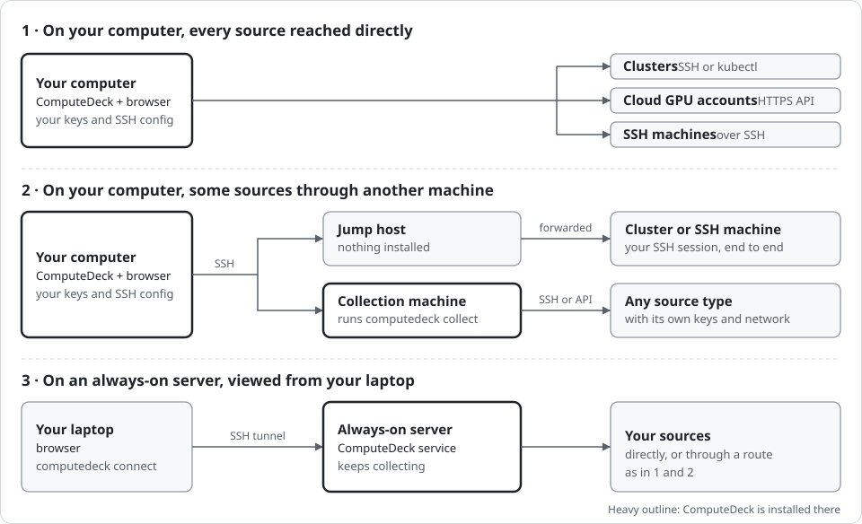

<p align="center"></p>

# ComputeDeck

ComputeDeck is a read-only dashboard for your GPU work, wherever it runs: Slurm, PBS, LSF
and Kubernetes clusters, cloud GPU accounts and your own SSH machines. It shows what is
running, why jobs wait or fail, what your instances cost and where your next run could
fit. It runs on your own computer with the SSH aliases and API keys you already have, and
needs no administrator access and no agent on the clusters.

[中文](README.zh-CN.md) · [Install](docs/install.md) · [Running ComputeDeck](docs/deployment.md) · [Configuration](docs/configuration.md) · [Plugins](docs/plugins.md) · [Changelog](CHANGELOG.md)


*Screenshots use ComputeDeck's built-in example data.*

## What you get

- **Every job in one place.** Running, queued and recently failed jobs across your
  cluster accounts, with the scheduler's own reason for each wait or failure and, when
  known, the time limit and log paths.
- **Where your next run fits.** Compare usable GPUs, QoS limits and your own queue by GPU
  model, count and run time, with the evidence behind each estimate. Copy matching Slurm
  flags; ComputeDeck never submits anything.
- **Cloud GPUs and their cost.** Instances on RunPod, Lambda, AWS EC2, Vast.ai and GPUhub
  with known hourly prices, cost so far, daily usage and hints about GPUs that sit idle.
- **Free GPUs on your machines.** Per-GPU memory, utilization and owners on SSH machines,
  NVIDIA or AMD.
- **Problems you can fix.** One Needs attention list you can clear item by item, a count
  of what still needs attention on every page (the age of the data when nothing does), and
  connection checks that name the step and the machine that failed.
- **Sources you cannot reach directly.** Reach a cluster through a jump host or a
  collection machine, so ComputeDeck can run on your laptop. Add-source forms suggest
  host aliases from your `~/.ssh/config`. The interface is in English and Chinese, on a
  desktop or a phone.

<table>
  <tr>
    <td width="40%"></td>
    <td width="40%"></td>
    <td width="20%"></td>
  </tr>
</table>

## Three ways to run it



1. **On your computer.** ComputeDeck reaches every cluster, cloud account and machine
   directly, with your SSH configuration and keys. It collects while it runs.
2. **On your computer, with routes.** A source your computer cannot reach goes through
   another machine. A **jump host** forwards your SSH connection and needs nothing
   installed. A **collection machine** has ComputeDeck installed and collects the source
   with its own keys, credentials and network.
3. **On an always-on server.** The service collects around the clock;
   `computedeck connect my-server` opens it from your laptop through an SSH tunnel.

Start with 1 and add a route per source when needed: a jump host when your own keys work on
the target, a collection machine when only that machine has the keys, VPN or software.
Choose 3 when collection must continue while your laptop sleeps. Moving from a server to
your laptop? `computedeck import --from my-server` adopts the server's sources and keeps
collecting them there, or reaches them through it as a jump host or directly
(`--route collect|jump|direct`). See [Running ComputeDeck](docs/deployment.md).


## Quick start

You need macOS or Linux, Python 3.12 or 3.13 and the OpenSSH client.

**From a release.** Each release on the [Releases
page](https://github.com/JiahaoZhang-Public/computedeck/releases) has a wheel with the web
app built in. Install it with `uv tool install` or `pipx` and run `computedeck serve
--open`; [Install](docs/install.md#install-a-release) has the exact commands, upgrades and
where your data lives. ComputeDeck is not on PyPI.

**From source.** If the Releases page lists no release yet, or you want the latest code,
build it with [uv](https://docs.astral.sh/uv/) and Node.js 22.18+ or 24:

```bash
git clone https://github.com/JiahaoZhang-Public/computedeck.git
cd computedeck
uv sync --frozen
npm --prefix web ci
npm --prefix web run build
uv run computedeck serve --open
```

The app opens at `http://127.0.0.1:8710`. Then:

- Turn on **Example data** to look around without connecting anything. Example mode
  blocks changes until you turn it off.
- Add a cluster under **Sources → Add source** with the SSH alias and username you
  already use; SSH must log in without prompts. For a cloud account, enter a credential
  reference such as `env:RUNPOD_API_KEY`, not the key. See
  [configuration](docs/configuration.md) and the [Slurm guide](docs/drivers/slurm.md).
- A source this computer cannot reach directly gets a **Route** in its form; add jump
  hosts and collection machines with **Add route** on the Sources page.
- Use **Test connection**, or `uv run computedeck doctor`, when a source fails. The
  [diagnostics guide](docs/doctor.md) explains each result. `computedeck --version` shows
  what is installed.

## Supported sources

| Clusters | Cloud GPUs | Other machines |
|---|---|---|
| Slurm, Kubernetes (beta), PBS (beta), LSF (beta) | RunPod, Lambda, AWS EC2, Vast.ai (beta), GPUhub (beta) | NVIDIA and AMD GPU machines over SSH; machines you add by hand |

Beta integrations have had limited testing on live systems; each [driver
guide](docs/drivers/) says what is known. Plugins can add more drivers.

## Numbers you can trust

- **Unknown stays unknown.** Missing or unreadable data is shown as unknown, never as
  zero or as free.
- **Partial totals say so.** They show `≥` and name the machines or logins that could
  not be measured.
- **One set of figures.** Overview, Usage & cost and history count the same way.
- **GPUs in use** are GPUs allocated to your jobs and held cloud instances, or GPUs with
  compute processes or significant memory use on SSH machines. This is not utilization.
- **Estimates are labelled.** Where to run, typical waits and costs are estimates, not
  scheduler promises or bills, and stale data shows its age.

[How the numbers are calculated](docs/metrics.md).

## Security and privacy

- **Read-only.** The core reads; it never submits jobs, stops instances or changes a cluster.
- **Local only.** The service listens on `127.0.0.1` and accepts changes only from its own page.
- **Optional access token.** Set `COMPUTEDECK_AUTH=token` on a machine other people use.
- **Credentials by reference.** Sources store `env:`, `keychain:` or `file:` references, never keys.
- **No telemetry.** Nothing is sent anywhere except the sources you configure, and the
  marketplaces and notification channels you choose to use.

Plugins run with your permissions. See [SECURITY.md](SECURITY.md) and [Running
ComputeDeck](docs/deployment.md#access-token).

## Plugins

Plugins add tools, source drivers, notification channels and pages. Install them on the
machine that runs the service and turn tools on in **Toolbox**; the built-in Notifications
and Team messages tools start switched off.

- [Official plugins](https://github.com/JiahaoZhang-Public/computedeck-plugins): network
  diagnostics and Shell credential references. Their first release is in preparation.
- [Write a plugin](docs/plugins.md): scaffold, Python API and web API.

## Roadmap

- **1.0:** the first stable release: one table of sources, a shorter path from a
  request to a place to run it, and an interface with fewer words on every page.
- **0.8:** routes through a jump host or collection machine so ComputeDeck
  runs on your laptop, connection checks that name the failing hop, a redesigned and
  quieter interface with detail on demand, a phone layout, and release packages built and
  checked in CI.
- **Next:** the first tagged release with a wheel on the Releases page, then PyPI once
  Trusted Publishing is set up; the first release of the official plugins.
- **Later:** a command palette and one place to add and repair connections; beta
  integrations graduate after testing on live systems.

Plans may change. Past releases are in the [changelog](CHANGELOG.md).

## Terms

| Term | Meaning |
|---|---|
| Source | One connection that is collected: a cluster login, a cloud API account or an SSH machine. |
| Cluster or platform | A group of resources under **Clusters & clouds** and in the group filter. |
| Route | How ComputeDeck reaches a source: directly from this computer, through a jump host, or collected by a collection machine. A routed login names its route in the **Route** column. |
| Jump host | A machine your SSH connections pass through, as with `ssh -J`. Nothing is installed on it; your keys and SSH configuration are used. |
| Collection machine | A machine with ComputeDeck installed that collects sources for you with its own keys, credentials and network. |
| Node | A compute node reported by a scheduler; not a route. |
| GPUs in use | Allocated or visibly busy GPUs, as defined above; not utilization. |
| Needs attention | The one list of current faults and warnings you have not dismissed or snoozed. A dismissed item returns when it changes. |

Job details use each scheduler's own terms, such as Partition and QoS for Slurm or Queue
for PBS and LSF.

## Contributing

Open a focused pull request that says what behaviour changed and which checks you ran. Use
fictional data in tests, docs and screenshots; see [AGENTS.md](AGENTS.md). Security
problems go to [SECURITY.md](SECURITY.md), not to issues.

```bash
bash scripts/check.sh        # lint, formatting, types, tests and web build
bash scripts/check-ui.sh     # browser UI gate: screenshots, axe, DOM checks
bash scripts/build.sh        # wheel and sdist with the web app, in dist/
bash scripts/smoke-wheel.sh dist/computedeck-*.whl   # install and use the built wheel
```

The Python service is in `src/computedeck`, the React app in `web`, and Python tests in
`tests`. [Local UI checks](docs/ui-testing.md) covers browsers, baselines and page
filters; [publishing](docs/publishing.md) covers releases.

## License

[Apache-2.0](LICENSE). See [NOTICE](NOTICE), and [THIRD_PARTY_NOTICES](THIRD_PARTY_NOTICES)
for the browser libraries bundled in the package.
