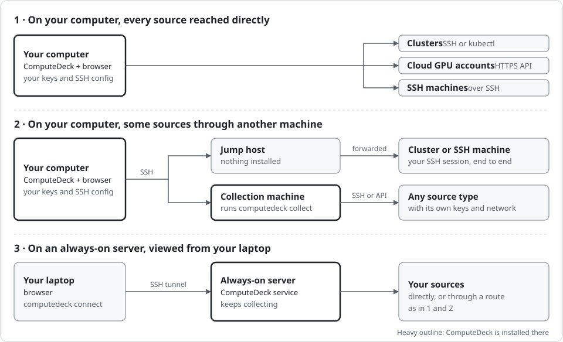

<p align="center"></p>

# ComputeDeck

ComputeDeck 是一个只读的 GPU 工作仪表盘：无论作业跑在 Slurm、PBS、LSF 还是 Kubernetes
集群上，还是在云 GPU 账号或你自己的 SSH 机器上，都能在一处看清。哪些作业在运行、
为什么排队或失败、实例花了多少钱、下一项任务适合放在哪里，一目了然。它在你自己的电脑上
运行，沿用你已有的 SSH 别名和 API 密钥，不需要管理员权限，也不用在集群上安装任何代理程序。

[English](README.md) · [安装](docs/install.md) · [运行方式](docs/deployment.md) · [配置说明](docs/configuration.md) · [插件开发](docs/plugins.md) · [变更记录](CHANGELOG.md)


*截图均使用 ComputeDeck 内置的示例数据。*

## 能做什么

- **所有作业集中查看。** 汇总各集群账号中运行、排队和最近失败的作业，显示调度器给出的
  排队或失败原因；已知时还会显示时长上限和日志路径。
- **下一项任务放在哪里。** 按 GPU 型号、数量和运行时长，比较可用 GPU、QoS 上限和你自己的
  排队需求，并说明每项估计的依据。可以复制相应的 Slurm 参数；ComputeDeck 从不提交作业。
- **云 GPU 及其费用。** 查看 RunPod、Lambda、AWS EC2、Vast.ai 和 GPUhub 上的实例、
  已知小时单价、累计费用、每日用量，以及长时间闲置 GPU 的提示。
- **自有机器上的空闲 GPU。** 显示 SSH 机器上每张 GPU 的显存、利用率和使用者，支持
  NVIDIA 和 AMD。
- **出了问题能修。** 统一的待处理列表，可逐项忽略；每个页面都显示仍需处理的数量（没有时
  显示数据的采集时间），连接检查会指出是哪一步、哪台机器出错。
- **直连不到的来源也能接入。** 通过跳板机或采集机器访问集群，让 ComputeDeck 可以直接在
  笔记本上运行。添加来源时会根据 `~/.ssh/config` 推荐主机别名。界面支持中文和英文，
  电脑和手机均可使用。

<table>
  <tr>
    <td width="40%"></td>
    <td width="40%"></td>
    <td width="20%"></td>
  </tr>
</table>

## 三种运行方式



1. **在你的电脑上运行。** ComputeDeck 用你的 SSH 配置和密钥直接访问所有集群、云账号和
   机器，运行期间持续采集。
2. **在你的电脑上运行，部分来源走路由。** 电脑直连不到的来源经由另一台机器访问。
   **跳板机**只转发你的 SSH 连接，无需安装任何东西；**采集机器**上安装了 ComputeDeck，
   用它自己的密钥、凭据和网络采集该来源。
3. **在常开的服务器上运行。** 服务全天采集；在笔记本上运行 `computedeck connect my-server`，
   通过 SSH 隧道打开它。

先从方式 1 开始，需要时再为单个来源加路由：你自己的密钥能登录目标机器时用跳板机；只有那台
机器才有密钥、VPN 或所需软件时用采集机器。笔记本休眠时也要继续采集，就选方式 3。
要从服务器迁到笔记本？运行 `computedeck import --from my-server` 即可接管服务器上的来源：
可以继续由服务器采集，也可以把它当作跳板机或改为直连（`--route collect|jump|direct`）。
详见[运行方式](docs/deployment.md)。


## 快速开始

需要 macOS 或 Linux、Python 3.12 或 3.13，以及 OpenSSH 客户端。

**安装发布版。** [Releases 页面](https://github.com/JiahaoZhang-Public/computedeck/releases)
上的每个版本都附带已内置网页的 wheel。用 `uv tool install` 或 `pipx` 安装后运行
`computedeck serve --open` 即可；具体命令、升级方法和数据存放位置见
[安装说明](docs/install.md#install-a-release)。ComputeDeck 尚未发布到 PyPI。

**从源码运行。** 如果 Releases 页面还没有任何版本，或者你想使用最新代码，可以用
[uv](https://docs.astral.sh/uv/) 和 Node.js 22.18+（或 24）构建：

```bash
git clone https://github.com/JiahaoZhang-Public/computedeck.git
cd computedeck
uv sync --frozen
npm --prefix web ci
npm --prefix web run build
uv run computedeck serve --open
```

页面地址为 `http://127.0.0.1:8710`。接下来：

- 开启**示例数据**，无需接入任何资源即可浏览界面。关闭前，示例模式会阻止一切修改。
- 在**来源 → 添加来源**中填写你已在使用的 SSH 别名和用户名接入集群；SSH 必须能够免交互
  登录。云账号的凭据请填写 `env:RUNPOD_API_KEY` 这样的引用，而不是密钥本身。详见
  [配置说明](docs/configuration.md)和 [Slurm 接入指南](docs/drivers/slurm.md)。
- 本机直连不到的来源，在来源表单中为它选择**路由**；跳板机和采集机器可在来源页面通过
  **添加路由**创建。
- 来源出错时，使用**测试连接**或 `uv run computedeck doctor --language zh-CN` 检查；
  结果说明见[诊断指南](docs/doctor.md)。`computedeck --version` 显示已安装的版本。

## 支持的来源

| 集群 | 云 GPU | 其他机器 |
|---|---|---|
| Slurm、Kubernetes（测试版）、PBS（测试版）、LSF（测试版） | RunPod、Lambda、AWS EC2、Vast.ai（测试版）、GPUhub（测试版） | 通过 SSH 访问的 NVIDIA / AMD GPU 机器；手动添加的机器 |

测试版集成在真实系统上的验证还有限，已知情况见各[驱动说明](docs/drivers/)。插件可以添加
更多驱动。

## 值得信赖的数字

- **未知就是未知。** 缺失或无法读取的数据显示为未知，绝不当作 0 或空闲。
- **不完整会标明。** 不完整的合计显示 `≥`，并列出未能测量的机器或登录身份。
- **口径一致。** 总览、用量与费用和历史曲线使用同一套统计方法。
- **在用 GPU** 指分配给你的作业和持有云实例的 GPU，或 SSH 机器上有计算进程、显存用量
  明显的 GPU；它不等于 GPU 利用率。
- **估计会注明。** 去哪跑、典型等待时间和费用都是估计，不代表调度器承诺或实际账单；
  过期数据会显示其采集时间。

详见[数字的计算方式](docs/metrics.md)。

## 安全与隐私

- **只读。** 核心只读取数据，从不提交作业、停止实例或修改集群。
- **仅限本机。** 服务只监听 `127.0.0.1`，只接受来自自身页面的修改。
- **可选访问令牌。** 与他人共用的机器上，设置 `COMPUTEDECK_AUTH=token`。
- **凭据只存引用。** 来源保存的是 `env:`、`keychain:` 或 `file:` 引用，而不是密钥。
- **不收集遥测。** 除了你配置的来源，以及你主动使用的插件市场和通知渠道，不会向任何地方
  发送数据。

插件以你的用户权限运行。详见 [SECURITY.md](SECURITY.md) 和[运行方式](docs/deployment.md#access-token)。

## 插件

插件可以添加工具、来源驱动、通知渠道和页面。请安装在运行服务的机器上，并在**工具箱**中
启用；内置的任务提醒和团队留言工具默认关闭。

- [官方插件](https://github.com/JiahaoZhang-Public/computedeck-plugins)：网络诊断和 Shell
  凭据引用，首次发布仍在准备中。
- [开发插件](docs/plugins.md)：项目模板、Python API 和网页 API。

## 路线图

- **0.8（进行中）：** 经由跳板机或采集机器的路由，让 ComputeDeck 可以在笔记本上运行；
  能指出出错环节的连接检查；重新设计、更简洁的界面（细节按需展开）和手机布局；在 CI 中
  构建并检查的发布包。
- **下一步：** 首个带 wheel 的正式发布（Releases 页面），配置好 Trusted Publishing 后
  再发布到 PyPI；官方插件的首次发布。
- **之后：** 命令面板，以及集中添加和修复连接的入口；测试版集成在真实系统上验证后转为
  正式支持。

计划可能调整。历史版本见[变更记录](CHANGELOG.md)。

## 术语

| 术语 | 含义 |
|---|---|
| 来源 | 一条被采集的连接：集群登录身份、云 API 账号或 SSH 机器。 |
| 集群或平台 | **集群与云平台**面板和分组筛选器中的资源分组。 |
| 路由 | ComputeDeck 访问来源的方式：从本机直连、经由跳板机，或由采集机器采集。走路由的登录身份在**路由**一列显示所用路由。 |
| 跳板机 | 转发你的 SSH 连接的机器，相当于 `ssh -J`。上面无需安装任何东西，使用的是本机的密钥和 SSH 配置。 |
| 采集机器 | 安装了 ComputeDeck、用它自己的密钥、凭据和网络为你采集来源的机器。 |
| 节点 | 调度器报告的计算节点，与路由无关。 |
| 在用 GPU | 已分配或明显在用的 GPU，定义见上文；不等于利用率。 |
| 待处理 | 当前故障和警告的统一列表，不含已忽略或暂缓的项目；已忽略的项目发生变化后会重新出现。 |

作业详情使用各调度器自己的术语，例如 Slurm 的分区和 QoS、PBS 和 LSF 的队列。

## 参与贡献

请让每个 PR 只解决一个具体问题，写明行为变化和执行过的检查。测试、文档和截图请使用虚构
数据，见 [AGENTS.md](AGENTS.md)。安全问题请按 [SECURITY.md](SECURITY.md) 私下报告，
不要提交公开 issue。

```bash
bash scripts/check.sh        # lint、格式、类型、测试和网页构建
bash scripts/check-ui.sh     # 浏览器 UI 检查：截图、axe、DOM 检查
bash scripts/build.sh        # 在 dist/ 中构建包含网页的 wheel 和 sdist
bash scripts/smoke-wheel.sh dist/computedeck-*.whl   # 安装并试用构建出的 wheel
```

Python 服务位于 `src/computedeck`，React 界面位于 `web`，Python 测试位于 `tests`。
浏览器、基线和页面筛选见[本地 UI 检查](docs/ui-testing.md)；发布流程见
[发布说明](docs/publishing.md)。

## 许可证

采用 [Apache-2.0](LICENSE)。见 [NOTICE](NOTICE)；包内附带的浏览器端依赖的许可声明见
[THIRD_PARTY_NOTICES](THIRD_PARTY_NOTICES)。
