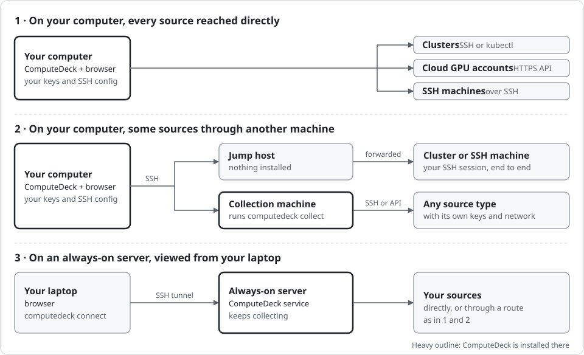

# Running ComputeDeck

ComputeDeck runs as one service that collects your sources and serves the web app on
`127.0.0.1`. Where you run it decides which network, keys and SSH configuration it uses.
[Install](install.md) explains how to install it; this page explains where to run it.



1. [On your computer](#1-on-your-computer), when it reaches every source directly.
2. [On your computer, with routes](#2-routes-sources-through-another-machine), when some
   sources are only reachable through another machine.
3. [On a server, viewed from a laptop](#3-on-a-server-viewed-from-a-laptop), when
   collection must continue while your laptop sleeps.

Start with 1 and add a route for each source that needs one. Choose 3 for collection around
the clock. The commands below assume an installed `computedeck`; in a source checkout,
put `uv run` in front of them.

## 1. On your computer

```sh
computedeck serve --open
```

The service collects only while it runs. Closing the browser does not stop it.

### Run at login

```sh
computedeck service install [--port 8710]
computedeck service uninstall
```

- **macOS** writes `~/Library/LaunchAgents/local.computedeck.service.plist`. The service runs while you are logged in, including with the screen locked.
- **Linux** writes `~/.config/systemd/user/computedeck.service`. To keep it running after you log out, run `loginctl enable-linger $USER` once.

The service runs with your user account, so it uses your `~/.ssh/config`, your SSH agent (if its socket is available to the service) and your keychain. Collection stops while the machine sleeps; a machine that should collect around the clock must not sleep automatically.

When asked to stop, the service waits at most 10 seconds for requests in flight (a browse of an unreachable machine, say), then cancels them and its background work. The service files give it 30 seconds (`ExitTimeOut` for launchd, `TimeoutStopSec` for systemd) before it is killed.

## 2. Routes: sources through another machine

A route tells ComputeDeck how to reach a source that this computer cannot reach directly:
a cluster behind a gateway, a machine on a lab network, a cluster that only one machine's
VPN or key can open. Each source has a **Route**: **Directly from this computer** (the
default), **Through {name} · jump host**, or **Collected by {name}**. A routed login names its
route in the **Route** column of the Sources page.

The **Routes** panel on the **Sources** page draws each route as a path, such as
*This computer → Lab gateway → Cluster B*, with its kind (Direct, Jump host or Collection
machine) and status. In a configuration file, routes are `[[node]]` entries.

### Jump host or collection machine

| | Jump host (`mode = "jump"`) | Collection machine (`mode = "collect"`) |
|---|---|---|
| What runs there | Nothing is installed. It only passes SSH connections on, as with `ssh -J`. | ComputeDeck, the same minor version as this computer. No service has to run. |
| Whose keys and SSH configuration | This computer's, for both hops: your `~/.ssh/config`, keys and agent. | That machine's own SSH configuration, keys and credential stores. |
| Whose network | The jump host opens the connection to the target, so private names and addresses are resolved there. Your SSH session runs end to end through it. | That machine's network, VPN and DNS. |
| Source types | Sources that connect over SSH: Slurm, PBS and LSF clusters, Kubernetes run over SSH, and SSH GPU machines. Not cloud API accounts. | Every source type, including cloud API accounts. |
| Where credentials resolve | On this computer. | On that machine. |
| Where collection runs | On this computer. | On that machine; results come back to this computer. |
| What a connection check shows | First **Reach {name} from this computer**, then the usual steps for the target. | Whether the machine answers, its ComputeDeck version and drivers, then the source's own check on that machine. |

Use a **jump host** when your own keys work on the target and you only lack the network
path. Use a **collection machine** when the target trusts only that machine's key, needs
its VPN or software, or is a cloud account whose key should stay there.

Results, history, events and notifications always stay on this computer, whichever route
collects them.

### Add a jump host

1. Make sure this computer reaches the jump host with a non-interactive `ssh <alias>`, and
   the target with `ssh -J <jump alias> <target alias>`. Log in to both once by hand so
   that their host keys are in this computer's `known_hosts`; ComputeDeck never accepts a
   new host key. The jump host's SSH server must allow TCP forwarding (OpenSSH's default).
2. On the **Sources** page, choose **Add route**. Under **What this machine does**, choose
   **Jump host** ("Forwards SSH. Nothing to install there."), enter a **Name** and the
   **SSH host alias** (suggested from your `~/.ssh/config`), and choose **Save and check**.
3. Edit each source that needs it and set its **Route** to **Through {name} · jump host**.
   The source's own SSH alias stays an alias in this computer's SSH configuration. Sources
   that do not connect over SSH cannot choose a jump host.

ComputeDeck passes the route to OpenSSH as an explicit `ProxyCommand` that runs
`ssh -W [%h]:%p` to the jump host's alias. It replaces any `ProxyJump` or `ProxyCommand` in
the target alias's Host block, so the connection takes exactly one path. The hop to the
jump host is as strict as every other connection: no prompts, a verified host key, a
10-second connect timeout and no forwarding. Settings of the jump host's own alias still
apply, including a `ProxyJump` of its own. The route carries everything ComputeDeck does
over SSH for that source: collection, connection checks, SSH checks of machines and the
job logs that notifications read. If your SSH configuration already reaches the target
through a `ProxyJump`, you do not need a route at all.

In a configuration file:

```toml
[[node]]
name = "Lab gateway"
ssh_alias = "lab-gateway"
mode = "jump"

[[cluster]]
label = "Cluster B"
username = "alice"
ssh_alias = "cluster-b"   # an alias in this computer's SSH configuration
node = "lab-gateway"
```

A source that does not connect over SSH is refused on a jump host, in the app and on
import, with a hint to use a collection machine instead. A route's kind cannot be changed
while sources use it.

### Add a collection machine

One ComputeDeck (the one you open) can collect some sources on other machines: a cluster
reachable only through one machine's VPN, a key that lives only there.

1. Install ComputeDeck on that machine; no service needs to run there. Use the same minor
   version as this computer.
2. Make sure the machine you open reaches it with a non-interactive `ssh <alias>`.
3. On the **Sources** page, choose **Add route**. Under **What this machine does**, choose
   **Collection machine** ("Runs ComputeDeck there, with its keys and network."), enter a
   **Name**, the **SSH host alias** and the **ComputeDeck command on that machine**. SSH
   commands do not load your login `PATH`, so a full path such as
   `~/.local/bin/computedeck` is often needed. **Save and check** runs `computedeck
   collect` there and shows its version and drivers.
4. Set the **Route** of those sources to **Collected by {name}**. Their SSH aliases and
   credential references must be valid on that machine.

Each collection runs `<command> collect` over SSH, sends the source's connection settings
on standard input and reads one JSON result back. The machine uses its own drivers, SSH
configuration, credentials and network; results, history, events and notifications stay
on the machine you open. Keep both on the same minor version; a different one is reported
on the source.

In a configuration file:

```toml
[[node]]
name = "Lab workstation"
ssh_alias = "lab-workstation"
command = "~/.local/bin/computedeck"
# mode = "collect" is the default

[[cluster]]
label = "Cluster C"
username = "alice"
ssh_alias = "cluster-c"   # an alias on the lab workstation
node = "lab-workstation"
```

The `node` key of a source is the route's `id`, which defaults to a slug of its name. A
`[[node]]` without `mode` is a collection machine, as in 0.7 and earlier, which have no
jump hosts. See [configuration](configuration.md#node) for every key.

### When a routed source fails

Connection checks and source errors name the hop that failed, so you know which machine
to fix.

- **Through a jump host:** a connection check starts with the step **Reach {name} from
  this computer**. If the jump host cannot be reached, that is the only step shown, and
  the error reads "Cannot reach the jump host {name} from this computer" followed by
  OpenSSH's own message. Otherwise the jump host is fine and the failure lies beyond it:
  the error is the usual SSH message about the target (authentication, host key, network
  or a missing command) and names the jump host it went through. When a collection fails,
  ComputeDeck reaches the jump host once on its own to tell the two apart; a successful
  collection makes no extra connection.
- **Through a collection machine:** **Save and check** first shows whether the machine
  answers and which ComputeDeck version and drivers it has. A source error then comes from
  the collection on that machine. To look closer, run `computedeck doctor` on that machine.

### Moving from a server to your laptop

If you ran the service on an always-on server and now want ComputeDeck on your laptop,
adopt the server's sources with one command on the laptop:

```sh
computedeck import --from my-server
```

This runs `computedeck export` on `my-server` over SSH (non-interactive, with strict host
key checking) and imports its sources. `--route` decides how the laptop reaches them:

| `--route` | What happens |
|---|---|
| `collect` (default) | `my-server` becomes a collection machine and keeps collecting every source with its own keys, credentials and network. ComputeDeck stays installed there, but its service is no longer needed. |
| `jump` | `my-server` becomes a jump host for the sources that connect over SSH; the others, such as cloud accounts, connect directly. Collection and credentials move to the laptop. |
| `direct` | Every source connects directly from the laptop. |

If `computedeck` is not on the server's `PATH` for non-interactive SSH, add
`--command ~/.local/bin/computedeck`; with `collect` it also becomes the collection
machine's command. With `jump` and `direct`, the sources' SSH aliases must be in the
laptop's `~/.ssh/config` (and, for `jump`, the targets' host keys in its `known_hosts`),
and credential references must resolve on the laptop: `env:` variables in its service's
environment, `keychain:` entries stored again, `file:` paths copied with mode 600.

The import leaves the server's settings, hand-added machines and its own routes behind.
If the server collects some sources through routes of its own, the import names them and
imports nothing: routes through two machines are not supported. Like any import, run it while the laptop's service
is stopped, or refresh in the app afterwards. It prints how the sources are routed and
reminds you to stop the old service; once the laptop collects them, run `computedeck
service uninstall` on the server. Then run `computedeck doctor`, or **Test connection**
for each source.

Collected history stays in the server's database. To keep it, restore a server backup on
the laptop instead of importing (see [Backups and restore](#backups-and-restore)), then set
each source's route in the app. Without SSH from the laptop to the server, copy the output
of `computedeck export` from the server and run `computedeck import <file>` on the laptop.

## 3. On a server, viewed from a laptop

Install the service on the server as in [Run at login](#run-at-login), then on your laptop:

```sh
computedeck connect my-server
```

This starts `ssh -N -L 127.0.0.1:8711:127.0.0.1:8710 my-server`, reads the server's access token with `ssh my-server computedeck token`, and opens the page: signed in with that token when the server asks for one, directly when it does not. Press Ctrl-C to disconnect; the server keeps collecting. Use `--remote-port` and `--local-port` if the ports differ. If `computedeck` is not on the server's `PATH` for non-interactive SSH, pass `--token-command "~/.local/bin/computedeck token"`, set `COMPUTEDECK_TOKEN`, or paste the token into the page. Avoid `--token <value>` on shared machines: other users can see command-line arguments.

In remote mode:

- SSH checks of instances run on the server, with the server's keys.
- **SSH configuration** produces a file for your laptop without the server's key paths.
- Backups are written on the server.
- Routes start from the server: a jump host must be reachable from the server, with the
  server's keys.

Set `server_name` in the configuration to control the name shown in the app. On a server
that other people can log in to, set `COMPUTEDECK_AUTH=token` (see [Access
token](#access-token)).

## Tools, plugins and policy

Tools that come with ComputeDeck (Notifications, Team messages) start switched
off; turn them on under **Toolbox**, which says what each will do. Plugins are
installed on the service machine with `computedeck plugin install` and loaded after a
restart; see [plugins.md](plugins.md). An administrator can put `policy.toml` in the data
directory to allow only certain marketplaces and to block plugins.

## Environment variables

| Variable | Default |
|---|---|
| `COMPUTEDECK_DATA_DIR` | platform user data directory |
| `COMPUTEDECK_PORT` | `8710` |
| `COMPUTEDECK_WEB_DIR` | the web app bundled with the package |
| `COMPUTEDECK_LOG_LEVEL` | `info` |
| `COMPUTEDECK_AUTH` | `off`; `token` makes every API request carry the access token (turn it on when other people have accounts on the machine that runs the service). Other values are refused, so a misspelling does not leave the service open |
| `COMPUTEDECK_BACKUPS` | `10`: backups kept in `<data dir>/backups` |

## Access token

Off by default. The service binds to `127.0.0.1`, which keeps other machines out, and accepts only the host names `127.0.0.1` and `localhost` and writes only from its own page (Origin and an `X-ComputeDeck` header), which keeps other websites out. That does not keep out other users of the same machine. On a machine shared with other people, set `COMPUTEDECK_AUTH=token`: every `/api` request then needs the token in `<data dir>/api-token` (mode 0600, created on first start). The token never appears in a URL or on a command line. `serve --open` and `connect` open a short-lived private page (mode 0600) in the data directory that posts a browser session token to `/api/session` (`serve --open` only once the listener has proved it is the process just started); the service checks it and answers with a page that stores it in `localStorage`, which belongs to that exact origin (host and port). Cookies are not used, because browsers send `127.0.0.1` cookies to every port, including servers run by other users. Before sending a stored session token, the page has the service prove it issued it (`/api/ping?session_challenge=`, an HMAC keyed by the session token); otherwise it forgets the token and asks you to sign in again. Opened any other way, the page asks for the token; `computedeck token` prints it. Scripts can send it in the `X-ComputeDeck-Token` header. Delete the file and restart the service to issue a new token. A file that holds no token (empty, blank, or anything but 16 to 512 letters, digits and `-._~+/=`) is replaced with a new token in the same way, and the replacement is logged.

## Backups and restore

**Settings → Backup** writes a consistent copy to `<data dir>/backups` and keeps the newest 10 (`COMPUTEDECK_BACKUPS`); older copies it wrote are removed. To restore, stop the service, copy a backup to a new data directory as `computedeck.sqlite`, and start the service with `COMPUTEDECK_DATA_DIR` pointing there. Backups contain no secrets; credential references must still resolve on the machine.

A database row that cannot be read (damaged, or written by a broken tool) is skipped rather than stopping the service: it is logged once, and `/api/health` counts such rows by table under `unreadable_rows`. A tool whose setup or startup fails is reported in the Toolbox; the rest of the service keeps running.

## Logs and startup permissions

The service writes application and uvicorn messages to `service.log` in its data directory.
Logs rotate at 5 MiB, keeping the active file and four backups (`service.log.1` through `.4`).
Existing oversized logs are retained when first rotated and expire as the backups turn over.
Log files are mode 600, including newly opened files after rotation. Startup restricts an
existing data directory to mode 700 and logs any permission correction.

New `computedeck service install` templates discard stdout and send only startup stderr to
`startup.log`; regular service logs go through the rotating handler. Reinstall the login
service to update an older template. On Linux the file is managed by systemd's `append:`
output mode; on macOS launchd uses `StandardErrorPath`.

Run [doctor](doctor.md) before changing a connection. Missing optional capabilities such as
accounting history do not count as failed sources; connection failures and stale data do.
